# Phase 11 — React + TypeScript Intelligence Dashboard

This document details the frontend architecture, component hierarchy, page routing, and state management for the **FinStream AI** dashboard.

---

## 1. Architecture Flow

```mermaid
flowchart TD
    subgraph FastAPI Backend
        REST[REST API Endpoints\n/api/v1/*]
        WS[WebSocket Stream\n/api/v1/ws/transactions]
    end

    subgraph React Application [dashboard/src]
        WSClient[FinStreamWebSocketClient\nAuto-Reconnect, Heartbeat Ping]
        ApiClient[Fetch API Client\nTyped Endpoints & Error Handling]

        WS -. Push Events .-> WSClient
        REST <-->|Queries & Pagination| ApiClient

        App[App Component\nReact Router + Layout]
        Navbar[Navbar Component\nConnection & Health Badges]
        Sidebar[Sidebar Component\nNavigation]

        App --> Navbar
        App --> Sidebar

        subgraph Pages
            Dash[Dashboard.tsx\nKPI Cards, Health Grid, Live Feed]
            TxPage[Transactions.tsx\nAudited Ledger, Account Search]
            TxDetail[TransactionDetails.tsx\nMetadata, Risk, SHAP Bar Chart]
            RiskPage[Risks.tsx\nAnomaly Monitor, Tier Filter]
            RiskDetail[RiskDetails.tsx\nModel Breakdown, Top SHAP Attributions]
            AccDetail[AccountDetails.tsx\nRedis Hot State & Account History]
        end

        App --> Dash
        App --> TxPage
        App --> TxDetail
        App --> RiskPage
        App --> RiskDetail
        App --> AccDetail
    end
```



---

## 2. Component Hierarchy & Responsibilities

| Component | Path | Responsibility |
| :--- | :--- | :--- |
| `Navbar` | `src/components/Navbar.tsx` | Header bar displaying live WebSocket connection state, research prototype badge, and API link. |
| `Sidebar` | `src/components/Sidebar.tsx` | Navigation menu providing routing to Dashboard, Transactions, and Risk Monitor. |
| `StatusCard` | `src/components/StatusCard.tsx` | Metric card with styled risk borders and icon accents. |
| `RiskBadge` | `src/components/RiskBadge.tsx` | Standardized risk indicator for `LOW` (green), `MEDIUM` (amber), and `HIGH` (red). |
| `TransactionTable` | `src/components/TransactionTable.tsx` | Formatted table rendering financial amounts with INR currency formatting (`₹`) and clickable links. |
| `RiskTable` | `src/components/RiskTable.tsx` | Relational table showing XGBoost probability, Isolation Forest score, and hybrid score with inline progress bars. |
| `ShapChart` | `src/components/ShapChart.tsx` | Horizontal feature attribution chart showing directional impact (`increases_anomaly` vs `decreases_anomaly`). |
| `LiveEventFeed` | `src/components/LiveEventFeed.tsx` | High-frequency scrolling event ticker displaying streaming events from WebSocket. |
| `ConnectionStatus` | `src/components/ConnectionStatus.tsx` | Pill status badge reflecting `CONNECTED`, `RECONNECTING`, or `DISCONNECTED` states. |
| `HealthStatus` | `src/components/HealthStatus.tsx` | Infrastructure health grid showing FastAPI, PostgreSQL, Redis, and WebSocket connectivity. |
| `Pagination` | `src/components/Pagination.tsx` | Offset/limit pagination control for historical datasets. |

---

## 3. Setup & Development

```bash
cd dashboard

# Install dependencies
npm install

# Run local development server
npm run dev
```
Access dashboard at `http://localhost:5173`.
