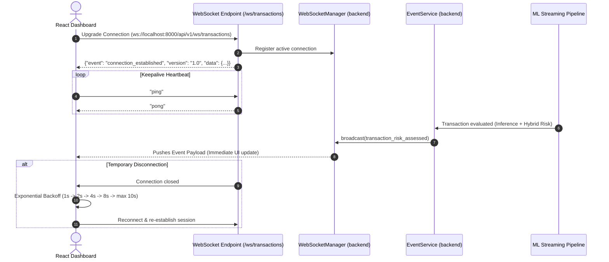

# Phase 12 — WebSocket Real-Time Streaming Architecture

This document details the WebSocket server implementation, connection manager, event schemas, keepalive protocol, and client reconnection logic for **FinStream AI**.

---

## 1. Streaming Lifecycle Flow



---

## 2. Event Envelope & Payload Schema

All WebSocket messages follow a standardized versioned schema:

```json
{
  "event": "transaction_risk_assessed",
  "version": "1.0",
  "timestamp": "2026-10-01T14:15:30.123456Z",
  "data": {
    "transaction_id": "TX000004",
    "account_id": "ACC0147",
    "amount": 350073.73,
    "currency": "INR",
    "merchant_category": "JEWELRY",
    "city": "Mumbai",
    "channel": "NET_BANKING",
    "hybrid_risk_score": 0.8074,
    "risk_level": "HIGH",
    "xgboost_probability": 0.7948,
    "isolation_forest_normalized": 0.8370,
    "top_shap_features": [
      {
        "feature": "amount",
        "feature_value": 350073.73,
        "shap_value": 0.9912,
        "absolute_shap_value": 0.9912,
        "direction": "increases_anomaly",
        "rank": 1
      }
    ]
  }
}
```

---

## 3. Resilience & Error Isolation

1. **Non-Blocking Broadcasting**:
   Broadcasting runs asynchronously and catches exceptions per client. If a client socket disconnects unexpectedly, it is safely removed from active connections without interrupting database persistence or crashing the server.

2. **Automatic Exponential Reconnection**:
   The React `FinStreamWebSocketClient` automatically attempts reconnection on disconnect using exponential intervals (`1s`, `2s`, `4s`, `8s`, max `10s`).

3. **In-Memory Buffer Cap**:
   The dashboard caps active in-memory streaming events to 100 items to prevent unbounded browser memory usage during long streaming sessions.
