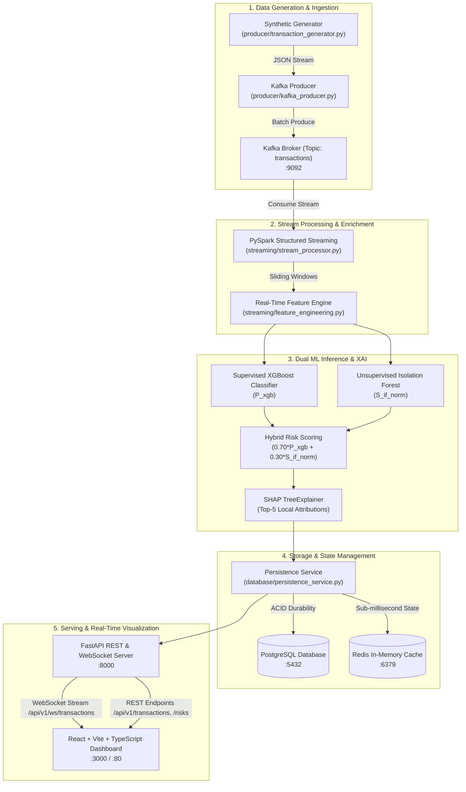

# Phase 13 — Full End-to-End Integration, Docker Deployment & Performance Validation

## 1. System Architecture & Topology

FinStream AI delivers an end-to-end real-time financial transaction intelligence and anomaly detection platform. Phase 13 brings all components together into an integrated, containerized microservice topology.



---

## 2. Service Definitions & Orchestration

The platform is orchestrated via `docker-compose.yml` comprising 6 microservices:

| Service | Container Name | Port | Description | Healthcheck / Dependency |
|---|---|---|---|---|
| `kafka` | `finstream_kafka` | `9092:9092` | Apache Kafka KRaft Single-Node Broker | Internal TCP check on `:9092` |
| `kafka-ui` | `finstream_kafka_ui` | `8080:8080` | Web UI for Kafka topic management | Depends on `kafka` |
| `postgres` | `finstream_postgres` | `5432:5432` | PostgreSQL 16 relational database | `pg_isready -U finstream -d finstream_db` |
| `redis` | `finstream_redis` | `6379:6379` | Redis 7 in-memory cache | `redis-cli ping` |
| `api` | `finstream_api` | `8000:8000` | FastAPI backend & real-time WebSocket server | Depends on `postgres` & `redis` healthy |
| `dashboard` | `finstream_dashboard` | `3000:80` | React + TypeScript Dashboard served via Nginx | Depends on `api` |

---

## 3. Deployment Commands

### Docker Compose Lifecycle
```bash
# Build and start all services in detached mode
docker compose up -d --build

# Inspect running containers and health status
docker compose ps

# View unified real-time logs
docker compose logs -f

# View backend API logs specifically
docker compose logs -f api

# Stop and remove all containers and networks
docker compose down

# Stop and wipe persistent storage volumes
docker compose down -v
```

### Local Development Mode
```bash
# Activate Python virtual environment
.\venv\Scripts\Activate.ps1

# Execute E2E pipeline benchmark
python -m scripts.benchmark_e2e --count 100 --scenario mixed

# Run full automated test suite
pytest tests/ -v
```

---

## 4. End-to-End Data Pipeline Verification

The pipeline guarantees strict data consistency across all processing stages:
1. **Correlation Preservation**: Every transaction is assigned an immutable `transaction_id` (`TX` + 6 hex digits) at generation time, propagated intact through Spark, ML inference, PostgreSQL persistence, and WebSocket push.
2. **Idempotency**: Duplicate transaction submissions are handled safely using SQL `ON CONFLICT DO NOTHING` and Redis deduplication keys.
3. **Graceful Degradation**: If Redis becomes temporarily unreachable, PostgreSQL guarantees ACID durability while the API continues serving cold historical queries.
4. **Zero-Drift Preprocessing**: Feature engineering ordering is strictly validated against `models/artifacts/feature_columns.json` to prevent feature misalignment.
