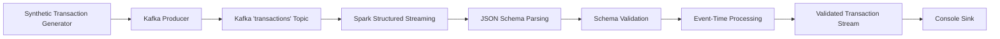

# Phase 4 — Real-Time Kafka Stream Processing with Apache Spark

This document describes the design, schema enforcement, event-time watermarking, and resilience mechanisms of the **FinStream AI** stream processing layer.

## 1. Architecture Flow



## 2. Event Time vs. Processing Time

* **Event Time (`event_time`)**: The exact timestamp when the transaction occurred at the originating client device/terminal (`2026-10-01T13:12:54Z`). All windowed aggregations, velocity calculations, and sliding state tracking use Event Time to ensure deterministic results regardless of network delays or backpressure.
* **Processing Time**: The wall-clock time when the Spark cluster ingested and processed the micro-batch.

## 3. Watermarking Strategy
* **Watermark Duration**: `5 minutes`
* **Purpose**: Allows Spark to accommodate moderately out-of-order or delayed transaction events while bounding the in-memory state store. Any event older than `max(event_time) - 5 minutes` is dropped to prevent memory exhaustion.

## 4. Spark Transaction Schema

```python
StructType([
    StructField("transaction_id", StringType(), False),
    StructField("timestamp", StringType(), False),
    StructField("account_id", StringType(), False),
    StructField("amount", DoubleType(), False),
    StructField("currency", StringType(), False),
    StructField("merchant_id", StringType(), False),
    StructField("merchant_category", StringType(), True),
    StructField("city", StringType(), True),
    StructField("device_id", StringType(), True),
    StructField("channel", StringType(), True),
    StructField("card_present", BooleanType(), True),
    StructField("transaction_type", StringType(), True),
    StructField("scenario_label", StringType(), True),
])
```

## 5. Fault Tolerance & Checkpointing
Structured Streaming utilizes Write-Ahead Logs (WAL) stored in `checkpoints/stream_processor`. This enables:
* Exactly-once or at-least-once stream state recovery upon restart.
* Preservation of current Kafka consumer partition offsets.

## 6. CLI Execution Commands

```powershell
# Run stream processor with default settings (starting offset: latest, trigger: 2s)
python -m streaming.stream_processor

# Ingest historical events from earliest available offset
python -m streaming.stream_processor --starting-offset earliest

# Custom trigger interval and watermark
python -m streaming.stream_processor --trigger-interval "1 second" --watermark "10 minutes"
```
