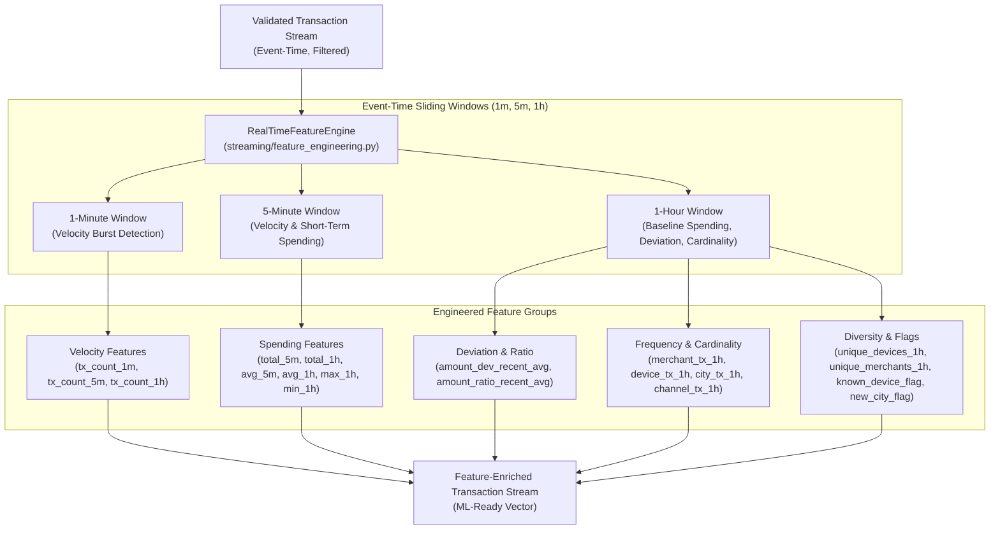

# Phase 5 — Real-Time Feature Engineering & Sliding Windows

This document details the feature engineering architecture, mathematical transformations, event-time sliding window definitions, and feature schemas in **FinStream AI**.

## 1. Architecture Flow

## 2. Feature Schema & Definitions (23 Features)

| Feature Name | Category | Window | Description / Formula |
| :--- | :--- | :--- | :--- |
| `amount` | Amount | Point-in-time | Raw transaction amount in INR |
| `log_amount` | Amount | Point-in-time | `ln(1 + amount)` (log1p transformation) |
| `transaction_count_1m` | Velocity | 1 Minute | Number of transactions for account in past 1m |
| `transaction_count_5m` | Velocity | 5 Minutes | Number of transactions for account in past 5m |
| `transaction_count_1h` | Velocity | 1 Hour | Number of transactions for account in past 1h |
| `total_amount_5m` | Spending | 5 Minutes | Total spending for account in past 5m |
| `total_amount_1h` | Spending | 1 Hour | Total spending for account in past 1h |
| `average_amount_5m` | Spending | 5 Minutes | Mean spending for account in past 5m |
| `average_amount_1h` | Spending | 1 Hour | Mean spending for account in past 1h |
| `maximum_amount_1h` | Spending | 1 Hour | Maximum transaction amount in past 1h |
| `minimum_amount_1h` | Spending | 1 Hour | Minimum transaction amount in past 1h |
| `amount_deviation_from_recent_avg` | Deviation | 1 Hour | `amount - average_amount_1h` |
| `amount_ratio_to_recent_avg` | Deviation | 1 Hour | `amount / average_amount_1h` (fallback 1.0) |
| `merchant_transaction_count_1h` | Frequency | 1 Hour | Transactions with specific merchant in past 1h |
| `device_transaction_count_1h` | Frequency | 1 Hour | Transactions using specific device in past 1h |
| `city_transaction_count_1h` | Frequency | 1 Hour | Transactions originating in specific city in past 1h |
| `channel_transaction_count_1h` | Frequency | 1 Hour | Transactions via specific channel in past 1h |
| `unique_device_count_1h` | Cardinality | 1 Hour | Count of distinct devices used by account in past 1h |
| `unique_merchant_count_1h` | Cardinality | 1 Hour | Count of distinct merchants visited in past 1h |
| `unique_city_count_1h` | Cardinality | 1 Hour | Count of distinct cities visited in past 1h |
| `unique_channel_count_1h` | Cardinality | 1 Hour | Count of distinct channels used in past 1h |
| `known_device_flag` | Flag | History | `1` if device previously observed, `0` if new |
| `new_city_flag` | Flag | History | `1` if city differs from recent cities, `0` if normal |

## 3. Sliding Window State Management

* **Event-Time Pruning**: The state engine prunes any historical event whose `event_time < current_event_time - 3600s`.
* **Account Isolation**: Each `account_id` has an independent sliding window state, preventing cross-tenant leakage.
* **Deterministic Fallbacks**: Missing or zero historical amounts safely evaluate to `deviation = 0.0` and `ratio = 1.0` (neutral multiplier).
