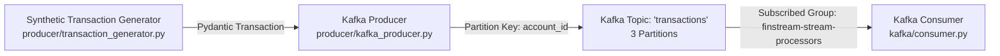

# Apache Kafka Setup, Architecture & Integration Guide

This directory outlines the Apache Kafka configuration, topic definitions, partition strategy, and consumer/producer components for **FinStream AI**.

## 1. Architecture Flow



## 2. Topic Architecture & Partitioning Strategy

| Topic Name | Partitions | Replication Factor | Partition Key | Purpose |
| :--- | :--- | :--- | :--- | :--- |
| `transactions` | 3 | 1 (Dev) | `account_id` (UTF-8 bytes) | Primary ingestion stream for raw synthetic transactions |
| `transaction_alerts` | 1 | 1 (Dev) | `transaction_id` | High-risk alerts published for downstream services |

### Why `account_id` as the Partition Key?
In Apache Kafka, messages with the same key are guaranteed to be routed to the same partition (via MurmurHash2 key hashing). By using `account_id` as the partition key:
1. All transactions belonging to a given account arrive sequentially in a single partition.
2. In subsequent phases, stateful stream processors (or consumer worker instances) can calculate rolling-window velocity and behavioral features for an account in strict chronological order without cross-partition synchronization bottlenecks.

## 3. Docker Compose Infrastructure (KRaft Mode)

Kafka runs in single-node **KRaft (Kafka Raft)** mode without requiring a separate ZooKeeper instance, reducing operational complexity:

```powershell
# Start Kafka and Kafka UI in background
docker compose up -d

# Verify broker status
docker compose ps

# Access Kafka UI web dashboard at:
http://localhost:8080
```

## 4. Producer (`producer/kafka_producer.py`)
Connects to the Kafka broker, reads events from `TransactionGenerator`, serializes records to JSON, sets `account_id` as the message key, and registers asynchronous delivery confirmation callbacks (`_on_delivery_success`, `_on_delivery_error`).

```powershell
# Continuous publishing at 5 TPS (mixed scenario)
python -m producer.kafka_producer --rate 5

# Publish high-amount scenario for 15 seconds at 2 TPS
python -m producer.kafka_producer --scenario high_amount --rate 2 --duration 15

# Custom broker and topic
python -m producer.kafka_producer --bootstrap-servers localhost:9092 --topic transactions
```

## 5. Consumer (`kafka/consumer.py`)
Subscribes to `transactions` as part of the `finstream-stream-processors` consumer group, parses incoming JSON payloads, validates schema against Pydantic `Transaction`, logs formatted summaries, and handles malformed payloads safely.

```powershell
# Start consumer listening from latest offset
python -m kafka

# Or execute script directly
python kafka/consumer.py

# Consume all existing messages from beginning
python kafka/consumer.py --from-beginning

# Limit consumption to N messages
python kafka/consumer.py --max-messages 50
```

## 6. Offset Management & Error Resilience
- **Offset Commit**: `enable_auto_commit=True` with `auto_commit_interval_ms=1000` for periodic offset checkpointing.
- **Broker Offline Handling**: Checks connectivity and provides human-readable diagnostic error messages if Kafka is offline (`ConnectionError`).
- **Malformed Payload Handling**: Safely catches `JSONDecodeError` and Pydantic `ValidationError`, increments error counters, and continues processing subsequent events without crashing.
